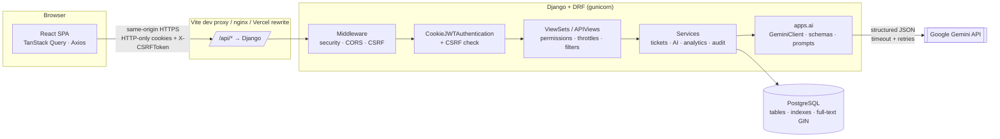
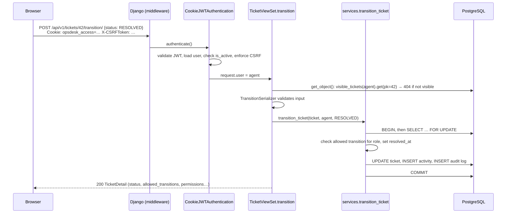
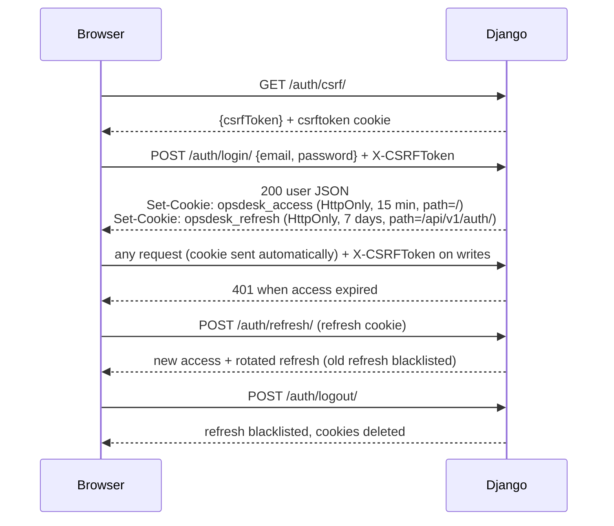
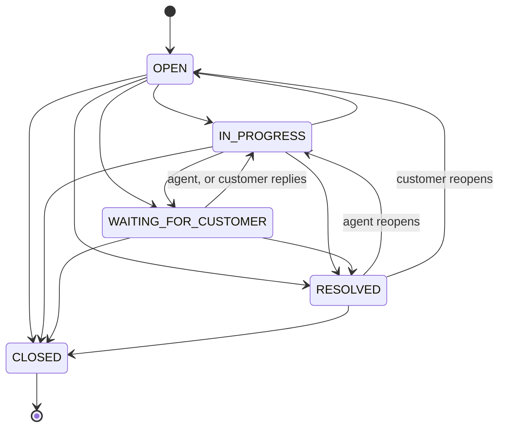
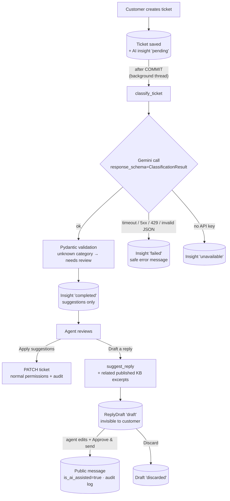
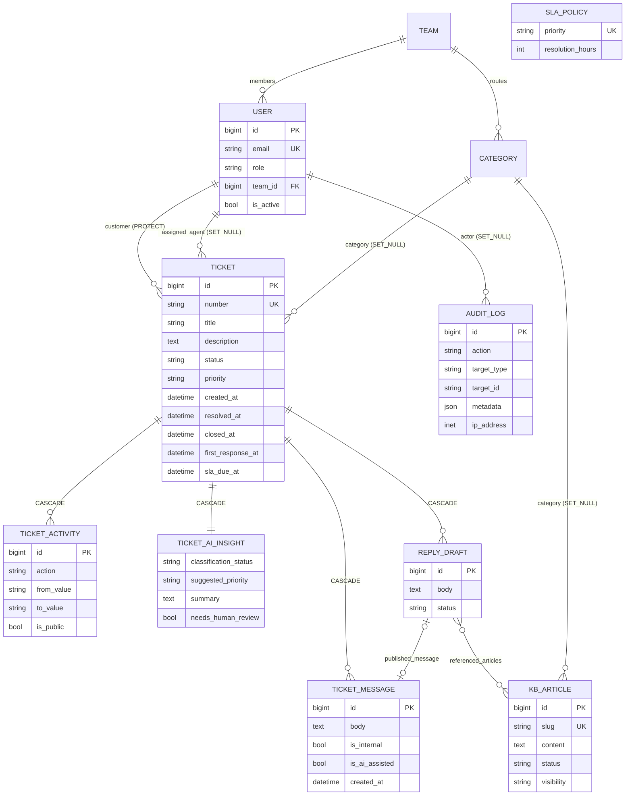

# Architecture

## Components

| Layer | Responsibility |
|---|---|
| **React SPA** | Pages and components. Server state lives in TanStack Query (cache, refetch, invalidation). It never stores tokens. |
| **Proxy** | Puts the SPA and API on one origin, so auth cookies are first-party and `SameSite=Lax` is enough. |
| **Middleware** | `SecurityMiddleware` (HSTS, nosniff, SSL redirect), WhiteNoise (static files), CORS, CSRF, clickjacking, plus a custom middleware adding CSP / `Cache-Control: no-store` to API responses. |
| **Authentication** | `CookieJWTAuthentication` reads the access JWT from an HTTP-only cookie, validates it, loads the user (rejecting inactive users), then runs Django's CSRF check. |
| **Views** | DRF viewsets. Thin: validate input with serializers, check permissions, call a service, serialize the output. |
| **Services** | Business rules: `tickets/services.py` (transitions, assignment, messages, SLA), `ai/services.py` (all Gemini use), `analytics/services.py` (aggregations), `audit/services.py`. |
| **Selectors** | Read-side access rules: `visible_tickets(user)`, `visible_articles(user)`. Every query starts from these, so authorization can't be forgotten. |
| **apps.ai** | The only module that talks to Gemini: client wrapper (timeouts, retries, error mapping), Pydantic schemas, prompts. |

## Request lifecycle (example: agent changes a ticket's status)

If the access token has expired, the API returns **401**. The Axios interceptor calls `POST /auth/refresh/` once; it is shared by all requests that failed at the same time. On success it retries the original request. If refresh fails, the cached user is cleared and the router sends the user to `/login`.

## Authentication & authorization

- Tokens are **never** in a JSON body or `localStorage`; JavaScript cannot read them (HTTP-only).
- The refresh cookie's `path` limits it to `/api/v1/auth/`, so it isn't sent with ordinary requests.
- **CSRF** is enforced for every cookie-authenticated write, including login and register (to block login-CSRF).
- **Rotation + blacklist:** each refresh issues a new refresh token and blacklists the old one, so a stolen, already-used refresh token is useless. A password change blacklists all of the user's refresh tokens.
- **Roles:** `User.role` ∈ {ADMIN, AGENT, CUSTOMER}. Public registration always creates CUSTOMER. Role checks happen in permission classes (`apps/core/permissions.py`), in services (e.g. who may assign), and in selectors (what you may see).

### Who can see which ticket (`apps/tickets/selectors.py`)

| Role | Visible tickets |
|---|---|
| Admin | all |
| Agent | assigned to them **or** in a category routed to their team **or** unassigned and not routed to any team (shared queue) |
| Customer | only their own |

Objects outside this set return **404** rather than 403, so ticket IDs can't be enumerated.

### Status transitions (`apps/tickets/services.py`)

Customers may only close their ticket (any active state) or confirm/reopen a resolution. Staff may make every other move shown. `CLOSED` is final; a closed ticket accepts no messages or edits.

## AI workflow

Safety properties:

1. **AI never acts on its own.** Classification only stores *suggestions*; an agent clicks "Apply". Reply drafts are invisible to customers until an agent publishes them, and every publication is audited.
2. **Structured output, validated twice.** The Pydantic model is sent as `response_schema` (Gemini returns JSON in that shape) *and* used locally with `model_validate_json`. Enums (priority) are constrained; text is trimmed and length-limited; empty answers are rejected.
3. **Citations can't be invented.** For KB answers and reply drafts, `used_article_ids` is intersected with the IDs actually sent in the prompt. If no article matches the question, Gemini isn't called at all and the API says the knowledge base doesn't cover it.
4. **Least data.** Prompts contain ticket text and role labels ("Customer", "Support agent"), not names or emails. Customer-facing features (KB answers, reply drafts) only use **published** articles the user may read; internal notes are only included in the agent-facing summary.
5. **Prompt-injection hygiene.** User text is wrapped in tags and the system instruction says to treat it as data. Combined with (1), a malicious ticket can at worst produce a bad suggestion that a human sees.
6. **Failure isolation.** Timeouts (20 s), one retry with backoff for 429/5xx/network errors, an input cap (`AI_MAX_INPUT_CHARS`), per-user AI rate limits, and mapping to safe messages (`503`/`429`). Ticket creation never waits for or depends on Gemini.

## Database schema

Design decisions:

- **Deletion behaviour:** customers and message authors are `PROTECT` (history must not vanish; users are *deactivated*, never deleted); assignee/category are `SET_NULL`; a ticket's messages/activities/insight/drafts `CASCADE` with it; audit logs keep `actor_email` as a snapshot.
- **Constraints:** check constraints on role/status/priority/visibility values, `resolved_at >= created_at`, SLA hours ≥ 1, unique ticket number, slug and email.
- **Indexes:** `(status, priority)`, `(customer, -created_at)`, `(assigned_agent, status)`, `sla_due_at`, `resolved_at`, `(ticket, created_at)` on messages/activities, `(action, created_at)` and `(target_type, target_id)` on audit logs, and a **GIN expression index** on `to_tsvector(title) || to_tsvector(content)` for full-text search.
- **Ticket numbers** (`OPS-000123`) are derived from the primary key inside the creating transaction. That's simple, unique and sequential, and avoids a separate counter table.
- **Activity vs. audit log:** `TicketActivity` is the user-facing timeline of one ticket (some entries are public to the customer). `AuditLog` is the security and compliance trail across the whole system (logins, user changes, publications), visible to admins only and read-only.

## Analytics & SLA

All metrics are single SQL aggregations (`COUNT(*) FILTER (WHERE …)`, `AVG(resolved_at - created_at)`, `GROUP BY date_trunc('day', …)`) run against the user's `visible_tickets` queryset, so agents only see their scope and customers only their own tickets. Agent workload (admins only) is one annotated query over users with filtered `COUNT`/`AVG` on the joined tickets.

- SLA deadline = `created_at + SLAPolicy.resolution_hours` for the ticket's priority, recomputed when the priority changes (unless an agent sets a manual deadline).
- `sla_status`: `met`/`breached` once resolved (comparing `resolved_at` to the deadline). For active tickets: `breached` when past the deadline, `at_risk` with < 25 % of the window left, otherwise `on_track`.
- Resolution time counts only tickets with a `resolved_at`; unresolved tickets and tickets closed without a resolution are excluded, and reopened tickets measure to their latest resolution.

## Frontend structure

- `src/lib/api.ts`: Axios instance with `withCredentials`, CSRF header injection, single-flight refresh on 401, and DRF error formatting.
- `src/api/*.ts`: one TanStack Query hook per endpoint; mutations invalidate the related caches (ticket detail, lists, analytics).
- `src/context/AuthContext.tsx`: the current user (from `/auth/me/`) plus role helpers.
- `src/components/layout/ProtectedRoute.tsx`: route guards by role, mirroring the API rules for UX (the API remains the enforcement point).
- `src/components/ui/*`: small shadcn-style components (Radix for dialog/menu/tabs; native `<select>` for accessibility).
- Pages are lazy-loaded; filters on the ticket list live in the URL so views can be shared and survive reloads.
